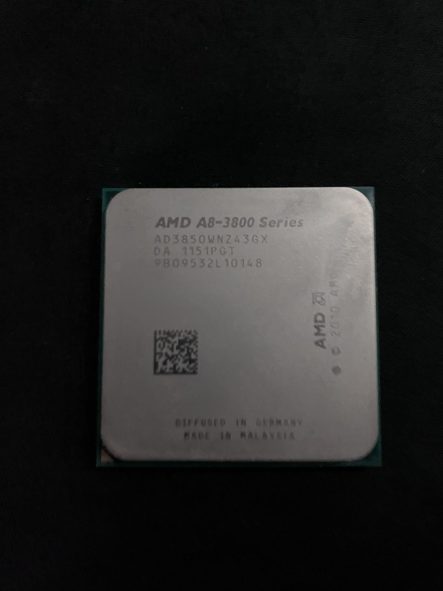
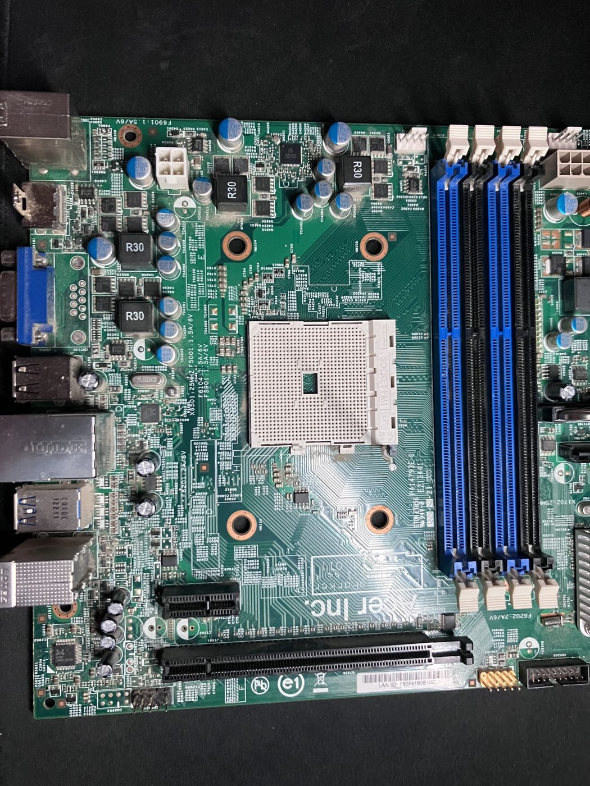
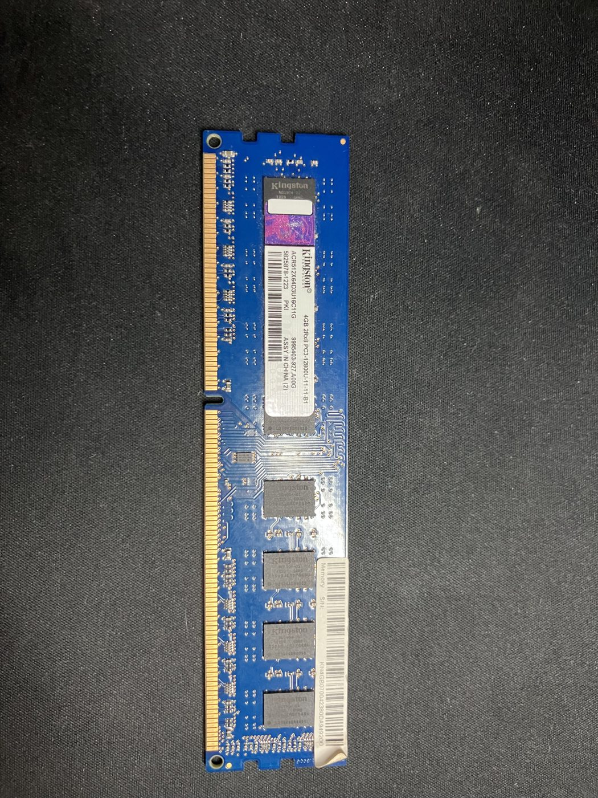
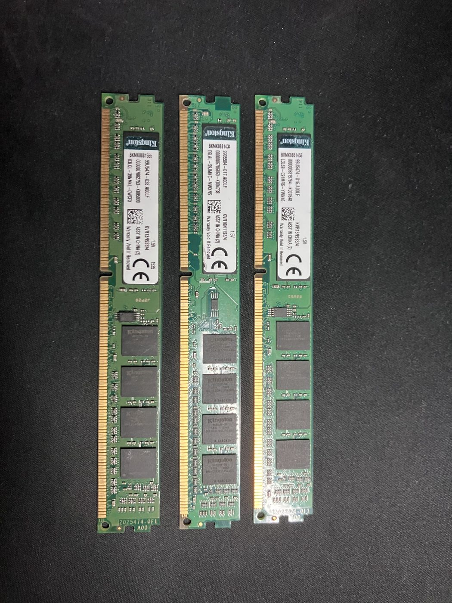
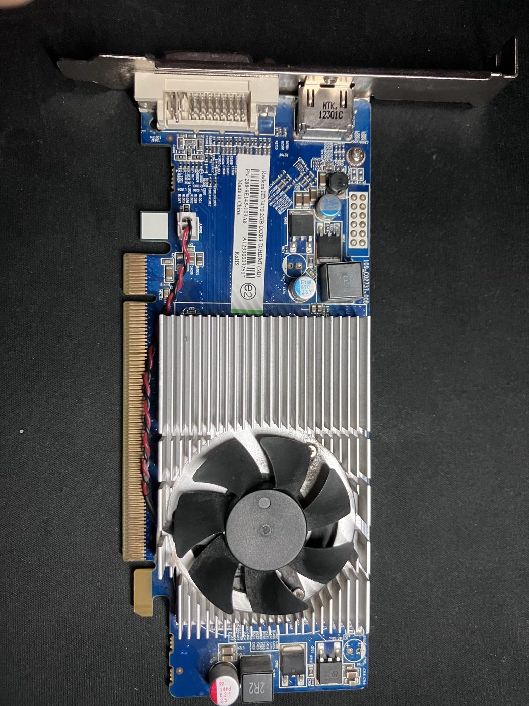
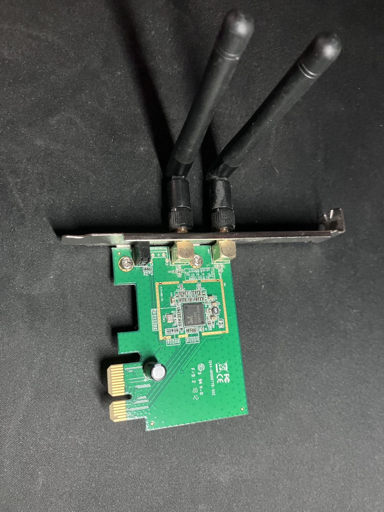

# Home Lab: hardware

Servidor casero construido combinando piezas de **dos PCs antiguos reciclados** (plataforma AMD FM1, 2011) y reconvertido en un host de virtualización con **Proxmox VE**. El objetivo es tener un entorno propio donde practicar administración de sistemas, redes y despliegue de servicios sin depender de la nube.

> Estado: hardware montado y Proxmox instalado. Aún sin máquinas virtuales ni contenedores creados.

## Objetivos

- Aprender virtualización y administración de servidores con Proxmox VE.
- Desplegar y probar servicios propios (VMs y contenedores LXC).
- Practicar redes, seguridad, copias de seguridad y automatización.
- Documentar todo el proceso de forma reproducible.

## Hardware

| Componente | Modelo | Especificaciones |
|---|---|---|
| **CPU** | AMD A8-3850 (serie A8-3800, "Llano") | 4 núcleos, 2,9 GHz, socket FM1, TDP 100 W, gráficos integrados Radeon HD 6550D |
| **Refrigeración CPU** | Cooler Master (disipador con ventilador de 80 mm) | Aire |
| **Placa base** | Acer (OEM), socket FM1 | 4 ranuras DDR3, 1x PCIe x16, 1x PCIe x1, 3x SATA, USB 3.0, VGA, HDMI, Ethernet |
| **RAM** | 4x Kingston 4 GB DDR3 UDIMM | **16 GB en total**, 1,5 V. Módulos DDR3-1333 y DDR3-1600 combinados (ver notas) |
| **GPU dedicada** | Radeon HD 7470 2 GB DDR3 | Perfil bajo, salidas DVI y HDMI, refrigeración activa |
| **Wi-Fi** | Adaptador MediaTek, tarjeta PCIe x1 | 2 antenas |
| **Almacenamiento** | SSD externo (USB) | Sistema operativo del host (Proxmox VE) |
| **Caja** | Caja de un PC Acer | Reciclada |

### Detalle de la memoria

| Módulo | Referencia | Velocidad |
|---|---|---|
| 1 | Kingston ACR512X64D3U16C11G (4 GB 2Rx8) | PC3-12800 (DDR3-1600) |
| 2 | Kingston KVR13N9S8/4 | DDR3-1333 |
| 3 | Kingston KVR16N11S8/4 | DDR3-1600 |
| 4 | Kingston KVR13N9S8/4 | DDR3-1333 |

### Notas

- **Memoria mixta:** al combinar módulos de distinta velocidad, el sistema funciona a la velocidad del más lento (DDR3-1333). Esa velocidad es justo el máximo que admite la placa base, así que combinar módulos de 1333 y 1600 no supone ninguna pérdida de rendimiento.
- **Almacenamiento externo:** Proxmox corre desde un SSD externo por USB. Es una solución práctica para empezar, y a futuro la idea es migrar a un almacenamiento interno.

## Software

- **Hipervisor:** Proxmox VE, en su última versión, instalado en el SSD externo.

## Red

El servidor se conecta a la red mediante un adaptador Wi-Fi MediaTek. A futuro me gustaría pasarlo a conexión por cable.

## Fotos

### CPU: AMD A8-3850

### Placa base: Acer, socket FM1

### Montaje: placa base con CPU, refrigeración y RAM

### Memoria RAM: Kingston DDR3 de 4 GB

### GPU: Radeon HD 7470 2 GB

### Wi-Fi: adaptador MediaTek PCIe

## Próximos pasos

- [ ] Montar servicios propios: una nube personal y **Vault to Garden**.

## Qué he aprendido

- **Identificar componentes:** leer las etiquetas y serigrafías de cada pieza (referencias de RAM, serie de la CPU, modelo de la GPU) para saber exactamente qué hardware tengo.
- **Compatibilidad de hardware:** comprobar el socket de la CPU (FM1), el tipo de memoria que admite la placa (DDR3) y su velocidad máxima antes de combinar piezas.
- **Memoria mixta:** cuando se combinan módulos de distinta velocidad, el sistema funciona a la del más lento, y eso no importa si ya es el límite de la placa.
- **Reutilizar hardware:** montar un solo equipo funcional a partir de piezas de dos PCs distintos.
- **Instalar Proxmox:** desplegar un hipervisor desde un SSD externo.
- **Conectividad:** configurar un servidor con adaptador Wi-Fi, con la idea de pasarlo a cable más adelante.
